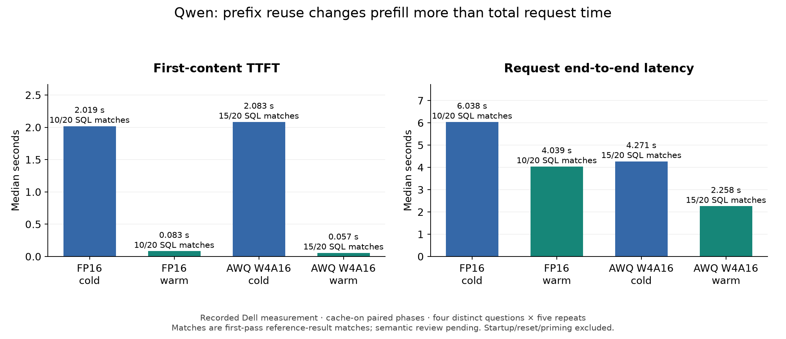
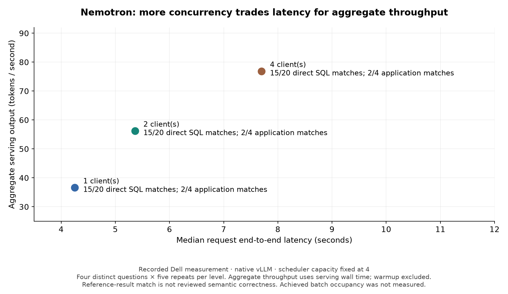

# What changed, what stayed useful?

**Recorded Dell measurements.** Four distinct clinical analytics questions on one 16 GiB
Quadro RTX 5000. Five serving repeats per question/condition give 20 requests, not 20
independent questions. These observations motivate decisions; they are not universal rankings.
All sources are [explicitly indexed](recorded_runs.json) and checked against the preserved
[checksum manifest](../notebooks/history/dell-2026-11-07/MANIFEST.json).

## Prefix reuse: prefill is only part of response time

| Cache-on configuration | Phase | Median TTFT s | Median request E2E s | Direct first-pass result match |
|---|---|---|---|---|
| Qwen FP16 | Cold | 2.019 | 6.038 | 10/20 |
| Qwen FP16 | Warm | 0.083 | 4.039 | 10/20 |
| Qwen AWQ W4A16 | Cold | 2.083 | 4.271 | 15/20 |
| Qwen AWQ W4A16 | Warm | 0.057 | 2.258 | 15/20 |

**Prediction:** repeated schema prefixes should chiefly reduce prefill work.

**Observation:** FP16's large cold/warm TTFT change accompanies a smaller E2E change.

**Explanation:** the paired observations are consistent with prefix reuse avoiding repeated
prefill while decoding still takes time. Caching and weight quantization address different
constraints; the recorded AWQ path also produced different SQL outcomes.

**Boundary:** these are paired cache-on phases, not a mix of supplemental warmed summaries
and separate baseline runs. SQL counts are reference-result matches with semantic review
pending. Native VRAM is missing, so this study establishes no memory reduction from AWQ.

**Decision:** test caching when schema/system prefixes repeat. Evaluate compatible AWQ
alongside latency and useful task results; do not assume four-bit weights guarantee speed.

Sources: [FP16 paired run](../experiment-tracker/mvp4/runs/20261106T224700_600112Z.json),
[AWQ paired run](../experiment-tracker/mvp4/runs/20261106T232408_684730Z.json).
Each target follows reset → cold → reset → different-question prime → identical target warm.
The shared schema prefix is identical. Startup, warmup, reset, prime and SQL scoring are
excluded from individual request clocks; successful reset acknowledgement is recorded.

## Output length before AWQ attribution

**Recorded Dell measurements**, from the same cache-on target records above:

| Precision | Phase | Requests | Mean output tokens | Median output tokens | Client-estimated decode tok/s p50 |
|---|---|---|---|---|---|
| FP16 | Cold | 20 | 152.00 | 143.00 | 35.14 |
| FP16 | Warm | 20 | 150.75 | 140.50 | 35.17 |
| AWQ W4A16 | Cold | 20 | 151.50 | 143.00 | 64.24 |
| AWQ W4A16 | Warm | 20 | 151.50 | 143.00 | 64.17 |

Shorter answers alone are not a sufficient aggregate explanation for AWQ's lower recorded
E2E: cold lengths have the same median, and warm AWQ output is slightly longer on average.
The effective client-estimated generation rate is higher in this stack. This is consistent
with a faster generation path, but it does **not** attribute the entire difference to GPU
kernels or identical computation. SQL/rationale text and token identities differ; token counts
also vary by case. Direct reference-result matches are 10/20 for FP16 and 15/20 for AWQ in
each phase, with semantic review pending.

Inspect [per-case and phase statistics](output_token_analysis.json), including token ranges,
before making a mechanism claim. [The analysis script](../scripts/tutorial/analyze_output_tokens.py)
reproduces them from checksum-verified sources. Decode rate here is the client estimate from
usage and E2E-minus-TTFT, not server/kernel profiling. Do not subtract unrelated medians as
though they were a request-level decomposition. No additional experiment was run for this audit.

## Concurrency: throughput and latency move together

At scheduler capacity 4, Nemotron's aggregate serving output rose from **36.622** to
**56.243** to **76.876 tok/s** for 1/2/4 clients, while median request E2E rose from
**4.251** to **5.362** to **7.699 s**. Direct reference-result matches stayed **15/20**;
application result matches were **2/4**. All are **recorded Dell measurements**.

**Prediction:** overlapping requests may improve utilization while increasing latency.

**Explanation:** aggregate throughput and per-request delay are different objectives.

**Boundary:** capacity is fixed here; achieved batch occupancy and scheduler traces were
not measured. Direct generation and application plan/SQL/repair have different quality counts.

**Decision:** choose concurrency for the deployment's latency limit and useful completed work.

Sources: [one client](../experiment-tracker/mvp4/nemotron/20261107T002501_223219Z.json),
[two clients](../experiment-tracker/mvp4/nemotron/20261107T025050_224975Z.json),
[four clients](../experiment-tracker/mvp4/nemotron/20261107T030851_257660Z.json).

## Context and request contracts are quality decisions

Nemotron's retrieved-schema application result match was **1/4**, versus **2/4** with full
schema. Fewer input tokens can remove required definitions. This observation is specific to
these cases and the frozen retrieval cache, not a claim that retrieval generally reduces quality.
Sources: [retrieved schema](../experiment-tracker/mvp4/nemotron/20261107T024417_765664Z.json),
[full-schema baseline](../experiment-tracker/mvp4/nemotron/20261107T002501_223219Z.json).

Qwen NIM's initial smoke had **4/4 transport successes and 0/4 application SQL executions**.
Every plan returned an object for `filters`; the application contract requires a string.
The schema-enforced rerun executed **3/4** application queries with **2/4** result matches.
These are different request configurations, not an unexplained retry improvement.
Sources: [original failure](../experiment-tracker/mvp4/nim/runs/20261107T213636_946106Z.json),
[constrained rerun](../experiment-tracker/mvp4/nim/runs/20261107T215439_693958Z.json).

## What remains unknown

- Native GPU memory: sampling failed because of UUID formatting. Historical values remain
  unavailable; the normalization fix needs a fresh GPU run. NIM memory samples exist but
  cannot fill gaps in native evidence.
- Human semantic correctness: unreviewed. See the [distinct-output review packet](SQL_REVIEW_DISTINCT.md).
  Broader quality conclusions require the full reference set and review.
- Automated live lifecycle: CPU tested, not freshly GPU validated. Manual Dell executions
  establish their own outcomes, not validation of the later automation.
- Causal NIM-versus-native gains: engine versions, thinking, request schemas, date/database
  and effective settings need matching first. No runtime winner is claimed.

The two figures can be regenerated with `python scripts/tutorial/render_findings.py`.
Their [numeric inputs and sources](figures/figure_data.json) are committed. Full evidence tables
and failure history remain in [the detailed findings](DELL_RESULTS.md).

## What should I choose?

| Need | What this study teaches |
|---|---|
| Faster first response with shared prefixes | Test prefix caching; report cold and warm separately |
| Lower-precision deployment | Validate checkpoint lineage, kernel compatibility and task quality |
| More simultaneous users | Measure aggregate throughput alongside per-request latency |
| Shorter prompts | Preserve required schema definitions; fewer tokens can reduce correctness |
| Packaged deployment | Evaluate NIM profiles, request contracts and operational setup |
| Embedded execution | Follow the separate [ExecuTorch portability branch](../notebooks/05_edge_portability_executorch.ipynb) |

These are experiment-selection lessons. No combined Nemotron “best configuration” was measured;
changing one factor at a time does not validate a combination of those factors.

## Qwen CPU portability — a separate deployment example

At the owner's request, the same Qwen3-4B base revision was tried through ExecuTorch on
Apple Silicon CPU. The full base snapshot fingerprint matches the Dell FP16 baseline.
The **8da4w** XNNPACK program exported and ran natively; one short-schema eval_001 SQL
query executed and matched its reference after native timing. The initial missing
quantized-embedding registration failure and successful retry are preserved.

This is a portability/SQL smoke, not another cell in the vLLM FP16/AWQ matrix: precision,
prompt, hardware, runtime and request path differ. See [chapter 05](../notebooks/05_edge_portability_executorch.ipynb)
and [the exact scope and reproduction stages](EXECUTORCH_MAC.md). SmolLM2 remains historical.

## Nemotron ExecuTorch compatibility

[Chapter 06](../notebooks/06_nemotron_executorch.ipynb) records a config-only probe
of the pinned Dell Nemotron 4B revision against the installed ExecuTorch 1.5.1 LLM
export configuration. Both Nemotron model-class candidates were rejected.
No native generation, SQL correctness, request timings or memory measurements
are available from this probe. This does not demonstrate that a custom port is
impossible; it identifies the missing validated hybrid model adapter.
[Raw probe](../experiment-tracker/tutorial/edge/nemotron-4b-compatibility-20261109.json).
